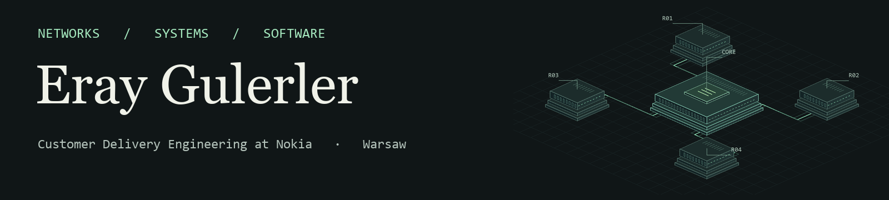

I work in **Customer Delivery Engineering at Nokia** in Warsaw and study **Computer Science and Information Systems at Warsaw University of Technology**. At Nokia I use Containerlab and SR Linux to reproduce network faults and check forwarding behaviour. My public projects cover market-data processing, authorization testing and release engineering.

**[Portfolio and interactive replay](https://eraygulerler.github.io/)** · **[LinkedIn](https://www.linkedin.com/in/eray-gulerler/)**

### Selected work

| Project | What to look for |
| --- | --- |
| [TickLadder](https://github.com/ErayGulerler/TickLadder) · C++20 | A two-level bitmap finds the next best quote after a price disappears. Tests compare the ladder with an ordered map over 300,000 random updates. |
| [ClaimFence](https://github.com/ErayGulerler/ClaimFence) · Python | A 55-case HTTP test suite checks tenant boundaries and separation of duties in an expense API, including four seeded regressions. |
| [CanaryLedger](https://github.com/ErayGulerler/CanaryLedger) · C++20 | A checkout release gate evaluates error and latency budgets. Includes CMake, Bazel and Jenkins configurations. |
| [BTC Execution Lab](https://github.com/ErayGulerler/BTC-Execution-Lab) · C++17, Python, SQL | A replay simulator compares evenly timed and historical-volume execution schedules on BTC spot data. |
| [Parcel invoice audit](https://github.com/ErayGulerler/parcel-invoice-audit) · PySpark, Snowpark | Resolves billing revisions, checks carrier tariffs and ranks potential overcharges for review. |

For a quick introduction, [step through TickLadder's sample tape](https://eraygulerler.github.io/#work), then inspect the [book implementation](https://github.com/ErayGulerler/TickLadder/blob/main/include/tickladder/book.hpp).
